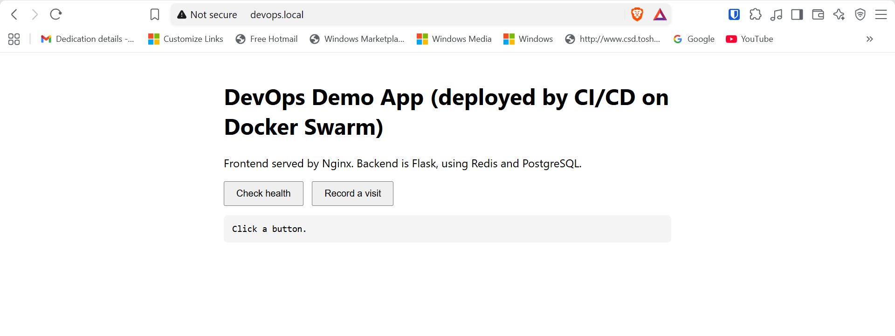
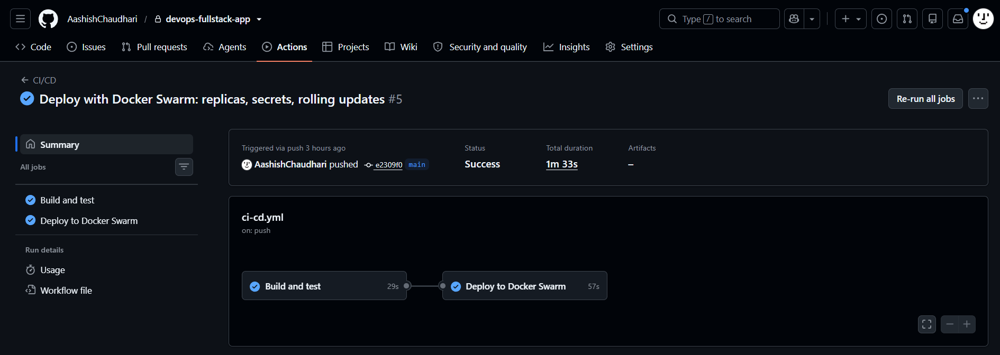
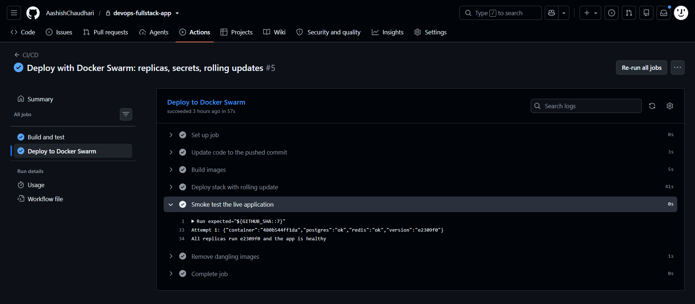
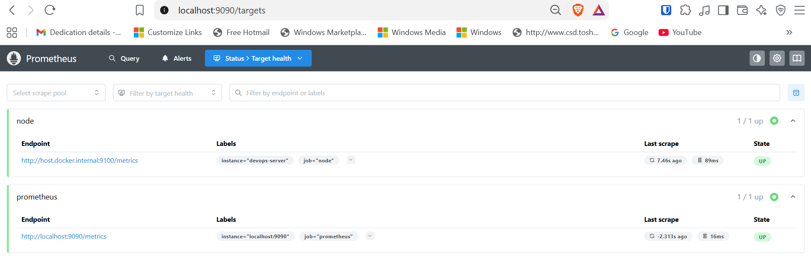
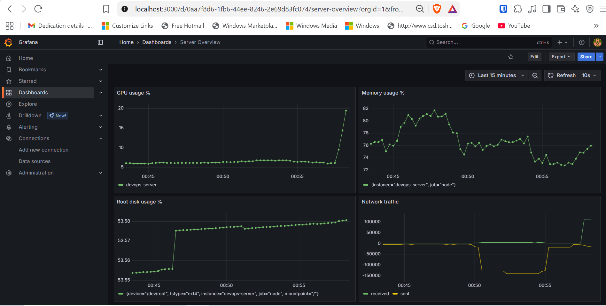
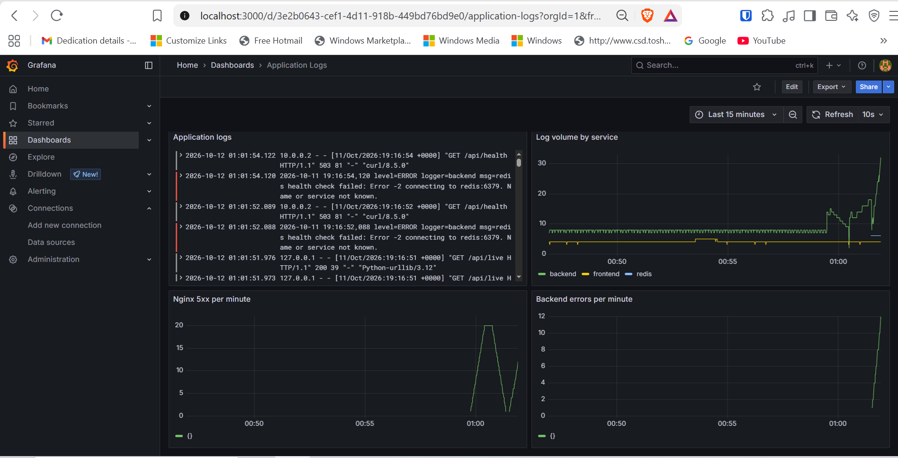
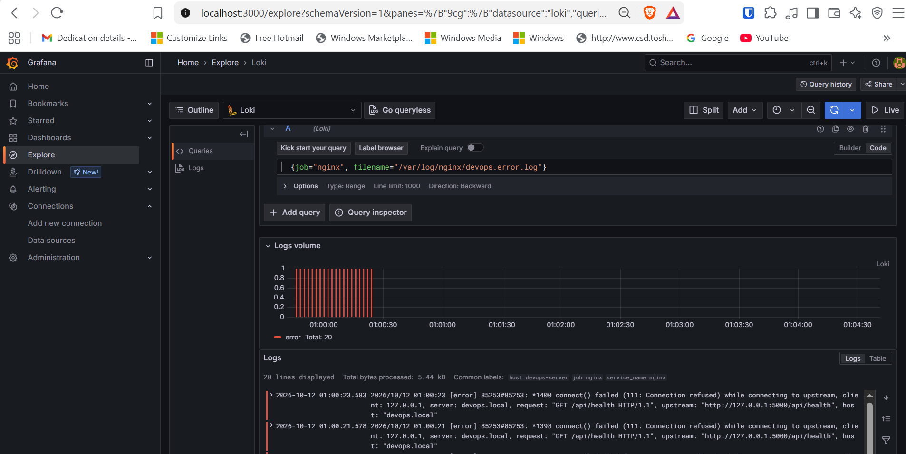
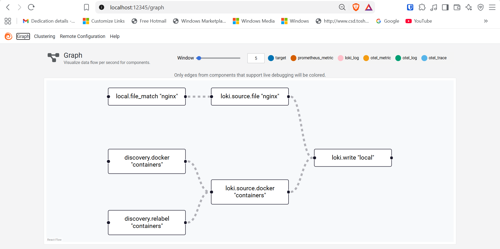
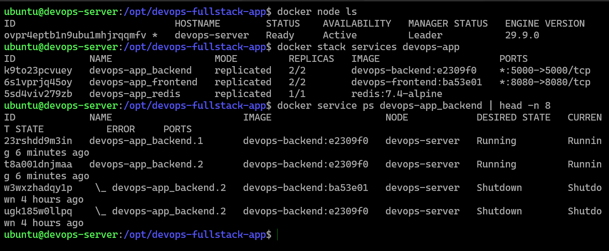
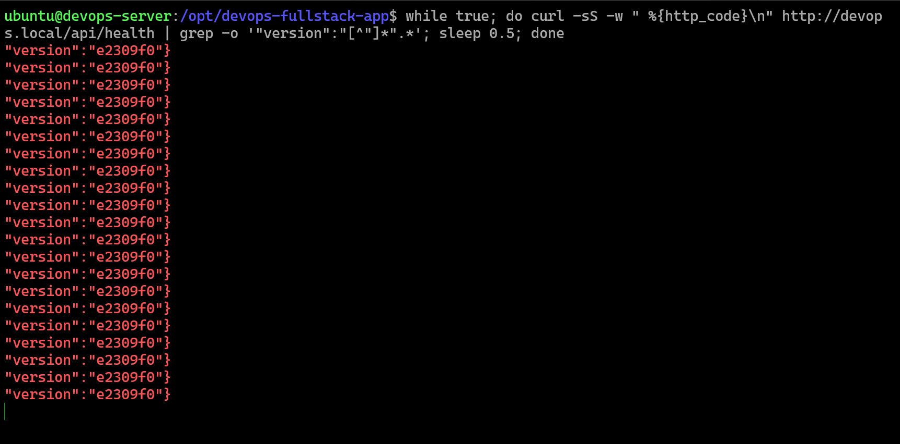

# DevOps Full-Stack Deployment

A simple frontend and backend application deployed on a single Ubuntu server, used to demonstrate containerization, reverse proxying, CI/CD, orchestration, monitoring, logging and troubleshooting.

The application is intentionally small. The focus of this project is everything around it: how it is built, deployed, secured, observed and debugged.

| Area | Implementation |
|---|---|
| Application | Flask backend (Python 3.12, Gunicorn), static HTML frontend |
| Containers | Docker, Docker Compose, Docker Swarm (bonus) |
| Database | PostgreSQL 16, installed directly on the host |
| Cache | Redis 7.4, in a container, password protected |
| Reverse proxy | Nginx on the host: `/` to frontend, `/api` to backend |
| CI/CD | GitHub Actions: hosted runner for tests, self-hosted runner for deployment |
| Monitoring | node_exporter, Prometheus, Grafana |
| Logging | Grafana Alloy, Loki, Grafana |
| Server | AWS EC2, Ubuntu 24.04 LTS, 2 vCPU, 1 GB RAM, 20 GB disk, ap-south-1 (Mumbai) |

---

## Table of contents

1. [Architecture](#1-architecture)
2. [Repository structure](#2-repository-structure)
3. [Application](#3-application)
4. [Server setup](#4-server-setup)
5. [Configuration and secrets](#5-configuration-and-secrets)
6. [Deployment](#6-deployment)
7. [CI/CD](#7-cicd)
8. [Docker Swarm (bonus)](#8-docker-swarm-bonus)
9. [Monitoring](#9-monitoring)
10. [Logging](#10-logging)
11. [Security](#11-security)
12. [Troubleshooting](#12-troubleshooting)
13. [Working within 1 GB of RAM](#13-working-within-1-gb-of-ram)
14. [Possible improvements](#14-possible-improvements)
15. [Screenshots](#15-screenshots)

---

## 1. Architecture

```
 Laptop browser
     |  http://devops.local   (hosts file -> EC2 public IP)
     v
 AWS security group: only 22 and 80 open, only from my IP
     |
 +---v-------------------------------- Ubuntu 24.04 (EC2) ---------------------------------+
 |                                                                                          |
 |  Nginx (host, port 80)                                                                   |
 |    /      -> 127.0.0.1:8080 -> frontend (2 replicas, nginx-unprivileged)                 |
 |    /api/  -> 127.0.0.1:5000 -> backend  (2 replicas, Flask + Gunicorn)                   |
 |                                    |                        |                            |
 |                         overlay network app-net      docker_gwbridge gateway             |
 |                                    v                        v                            |
 |                            Redis (1 replica,         PostgreSQL 16 (host, systemd)       |
 |                            volume redis-data)                                            |
 |                                                                                          |
 |  Monitoring (Docker Compose project "monitoring"):                                       |
 |    node_exporter (host) <- Prometheus <- Grafana                                         |
 |    container logs + Nginx logs -> Alloy -> Loki <- Grafana                               |
 |                                                                                          |
 |  GitHub Actions self-hosted runner (systemd service, outbound connection only)           |
 +------------------------------------------------------------------------------------------+
     ^
     |  SSH tunnel (ports 3000, 9090, 12345) for Grafana, Prometheus and the Alloy UI
 Laptop
```

### Key design decisions

| Decision | Reason |
|---|---|
| Nginx on the host as the single entry point | One public port (80). Containers are never exposed directly. Central place for routing, and later TLS and rate limiting |
| PostgreSQL on the host, not in a container | Required by the assignment, and common practice: the database holds data that must outlive containers and is managed separately |
| Redis in a container with no published port | Only the backend needs it; it is reachable only inside the Docker network |
| Container ports bound to `127.0.0.1` (Compose) | Only Nginx can reach them. Docker's published ports bypass UFW, so binding to localhost avoids relying on one firewall layer |
| Configuration through environment variables and secrets | The same image runs anywhere; secrets never live in code or Git |
| Images tagged with the Git commit ID | Every running container can be traced to an exact commit; enables rollback |
| Self-hosted runner for deployment | No inbound port and no SSH key stored in GitHub. The runner connects outbound to GitHub |
| Monitoring as a separate Compose project | Application deployments never restart the monitoring stack |
| Monitoring UIs only on localhost, reached through an SSH tunnel | Dashboards reveal system details and are never exposed to the internet |

---

## 2. Repository structure

```
devops-fullstack-app/
├── .github/workflows/ci-cd.yml          # CI/CD pipeline
├── backend/
│   ├── app.py                           # Flask API
│   ├── requirements.txt                 # Pinned dependencies
│   ├── Dockerfile
│   ├── .dockerignore
│   └── tests/test_app.py                # Unit tests (pytest)
├── frontend/
│   ├── index.html                       # Static page calling /api
│   └── Dockerfile
├── nginx/devops.local.conf              # Copy of the host Nginx site config
├── monitoring/
│   ├── docker-compose.yml               # Prometheus, Grafana, Loki, Alloy
│   ├── .env.example
│   ├── prometheus/prometheus.yml
│   ├── loki/loki-config.yaml
│   ├── alloy/config.alloy
│   └── grafana/
│       ├── provisioning/datasources/datasources.yml
│       └── dashboards/                  # Exported dashboard JSON
├── docs/screenshots/                    # Evidence screenshots
├── docker-compose.yml                   # Single-host deployment (Compose)
├── stack.yml                            # Docker Swarm deployment (bonus)
├── .env.example                         # Template for the real .env (never committed)
└── .gitignore
```

---

## 3. Application

### Backend endpoints

| Endpoint | Method | Purpose |
|---|---|---|
| `/api/live` | GET | **Liveness**: returns 200 if the process can serve HTTP. Used by the Swarm health check |
| `/api/health` | GET | **Readiness**: checks PostgreSQL and Redis. Returns 200 if both are reachable, 503 otherwise. Reports the running version and container ID |
| `/api/visit` | POST | Increments a counter in Redis and inserts a row in PostgreSQL |

Example:

```bash
$ curl -s http://devops.local/api/health
{"container":"0953c3bacd40","postgres":"ok","redis":"ok","version":"e2309f0"}
```

- `version` is the short Git commit ID, set by the pipeline. It proves which build is running.
- `container` shows which replica answered (useful with Swarm load balancing).

### Frontend

A single static HTML page served by `nginxinc/nginx-unprivileged`. It calls `/api/health` and `/api/visit` with relative paths, so it never needs to know the backend's address, and there are no CORS issues (same origin through the reverse proxy).

### Container images

| Image | Base | Notes |
|---|---|---|
| backend | `python:3.12-slim` | Non-root user (UID 10001); dependencies installed before code is copied for layer caching; `PYTHONUNBUFFERED=1` so logs reach stdout immediately; Gunicorn with 2 workers, started in exec form so it receives SIGTERM |
| frontend | `nginxinc/nginx-unprivileged:1.27-alpine` | Runs as non-root, listens on 8080 |

`slim` was chosen over `alpine` for Python because packages with compiled parts (like the PostgreSQL driver) can fail on Alpine's musl C library.

---

## 4. Server setup

These steps were done once on a fresh Ubuntu 24.04 EC2 instance.

### 4.1 EC2 and security group

- Ubuntu Server 24.04 LTS, 20 GB gp3, ap-south-1
- Inbound rules: SSH (22) and HTTP (80), source **My IP** only
- Ports 3000, 5000, 5432, 8080, 9090, 9100 are **not** opened; verified with `Test-NetConnection` from the laptop

### 4.2 Base system

```bash
sudo apt update && sudo apt upgrade -y
sudo apt install -y git curl ca-certificates htop unzip
sudo hostnamectl set-hostname devops-server
echo "preserve_hostname: true" | sudo tee /etc/cloud/cloud.cfg.d/99-hostname.cfg
sudo timedatectl set-timezone Asia/Kathmandu
```

Swap (the server has only 1 GB of RAM):

```bash
sudo fallocate -l 3G /swapfile
sudo chmod 600 /swapfile
sudo mkswap /swapfile
sudo swapon /swapfile
echo '/swapfile none swap sw 0 0' | sudo tee -a /etc/fstab
echo 'vm.swappiness=10' | sudo tee /etc/sysctl.d/99-swappiness.conf
echo 'vm.overcommit_memory = 1' | sudo tee /etc/sysctl.d/99-redis.conf
sudo sysctl --system
```

`vm.overcommit_memory = 1` is required by Redis for background saves. It is a kernel setting, so it is set on the host: containers share the host kernel.

### 4.3 Docker

Installed from Docker's official apt repository (signed with Docker's GPG key), with the Compose plugin:

```bash
sudo apt install -y docker-ce docker-ce-cli containerd.io docker-buildx-plugin docker-compose-plugin
sudo usermod -aG docker ubuntu
```

Log rotation in `/etc/docker/daemon.json`, so container logs cannot fill the disk:

```json
{
  "log-driver": "json-file",
  "log-opts": { "max-size": "10m", "max-file": "3" }
}
```

### 4.4 PostgreSQL (on the host)

```bash
sudo apt install -y postgresql
sudo -u postgres createuser appuser
sudo -u postgres psql -c "\password appuser"     # password typed interactively, never in history
sudo -u postgres createdb -O appuser appdb
```

- `appuser` has no superuser or create-database rights, and owns only `appdb`.
- `listen_addresses = '*'` in `/etc/postgresql/16/main/conf.d/listen.conf`, so containers can connect through the Docker bridge. Listening on all interfaces avoids a boot-time race with Docker's interfaces. Access is restricted by the other layers below.
- `/etc/postgresql/16/main/pg_hba.conf` allows only the Docker networks, only for `appuser` and `appdb`, only with a password:

```
host    appdb    appuser    172.28.0.0/24      scram-sha-256   # Compose network (pinned subnet)
host    appdb    appuser    172.19.0.1         scram-sha-256   # Swarm docker_gwbridge network
```

Defense in depth for the database: security group (5432 closed) + `pg_hba.conf` (only Docker subnets) + SCRAM password authentication + least-privilege user.

Note: on Ubuntu, `postgresql.service` is only a wrapper. The real database runs as `postgresql@16-main.service`.

### 4.5 Nginx

```bash
sudo apt install -y nginx
sudo cp nginx/devops.local.conf /etc/nginx/sites-available/devops.local
sudo ln -s /etc/nginx/sites-available/devops.local /etc/nginx/sites-enabled/devops.local
sudo rm /etc/nginx/sites-enabled/default
sudo nginx -t && sudo systemctl reload nginx
```

The config (see [`nginx/devops.local.conf`](nginx/devops.local.conf)):
- routes `/api/` to the backend and `/` to the frontend
- uses `proxy_pass http://backend;` **without** a trailing slash, so `/api/health` reaches Flask unchanged
- passes `Host`, `X-Real-IP`, `X-Forwarded-For` and `X-Forwarded-Proto`
- has a `default_server` that returns `444` (close connection), so requests by bare IP or unknown hostnames get nothing
- sets `server_tokens off` and short upstream timeouts
- writes separate access and error logs (`/var/log/nginx/devops.*.log`), which Alloy ships to Loki

### 4.6 Local hostname

On the server, `/etc/hosts`:

```
127.0.0.1 devops.local
```

On the laptop (`C:\Windows\System32\drivers\etc\hosts`):

```
<EC2-PUBLIC-IP>  devops.local
```

The application is then available at **http://devops.local**.

### 4.7 Git access on the server

The repository is private. The server uses a **read-only deploy key** scoped to this repository only (`~/.ssh/github_deploy`, configured in `~/.ssh/config`). If the server were compromised, the key could not push code or reach any other repository.

The application lives in `/opt/devops-fullstack-app`.

---

## 5. Configuration and secrets

All configuration comes from environment variables or secret files. Nothing secret is committed.

| File | Committed | Purpose |
|---|---|---|
| `.env.example` | yes | Documents required variables with placeholder values |
| `.env` | **no** (`.gitignore`) | Real values on the server, `chmod 600` |
| `monitoring/.env.example` | yes | Grafana admin user and password template |
| `monitoring/.env` | **no** | Real Grafana password |

Passwords were generated with `openssl rand -hex 24` (hex avoids characters that break `.env` files and URLs).

### Docker Compose mode

`docker-compose.yml` loads `.env` with `env_file`. Variable precedence: shell environment (used for `${...}` interpolation) > `environment:` > `env_file:`. `APP_VERSION` is set explicitly under `environment:` so the pipeline's value always wins over the `dev` default in `.env`.

### Docker Swarm mode

Passwords are **Swarm secrets**, created from the server's `.env` without ever being printed:

```bash
grep '^DB_PASSWORD=' .env | cut -d= -f2- | tr -d '\n' | docker secret create db_password -
grep '^REDIS_PASSWORD=' .env | cut -d= -f2- | tr -d '\n' | docker secret create redis_password -
```

The backend reads `DB_PASSWORD_FILE` / `REDIS_PASSWORD_FILE` (`/run/secrets/...`) through `read_secret()` in `app.py`, falling back to plain variables in Compose mode. Inside a Swarm container, `printenv` shows only the file paths, never the passwords.

### Secret hygiene

During setup, the database password was accidentally shared in a log excerpt. It was **rotated** immediately (new password on the database user, `.env` updated, backend recreated). A secret that has left the server is treated as compromised; deleting the message is not enough.

---

## 6. Deployment

The current deployment uses **Docker Swarm** (section 8). Docker Compose is kept as a single-host alternative.

### With Docker Swarm (current)

Deployed automatically by the pipeline. Manually:

```bash
cd /opt/devops-fullstack-app
export APP_VERSION=$(git rev-parse --short=7 HEAD)
docker build -t devops-backend:$APP_VERSION ./backend
docker build -t devops-frontend:$APP_VERSION ./frontend
docker stack deploy --compose-file stack.yml --resolve-image never --detach=false devops-app
docker stack services devops-app
```

### With Docker Compose (alternative)

```bash
cd /opt/devops-fullstack-app
cp .env.example .env && chmod 600 .env       # then fill in real values
export APP_VERSION=$(git rev-parse --short=7 HEAD)
docker compose up -d --build
docker compose ps
```

Always export `APP_VERSION` before running Compose by hand. Without it, Compose falls back to `dev`, builds an untracked image and silently replaces the deployed version.

### Monitoring stack

```bash
cd /opt/devops-fullstack-app/monitoring
cp .env.example .env && chmod 600 .env       # set GRAFANA_ADMIN_PASSWORD
docker compose up -d
```

### Verify

```bash
curl -sS -i http://devops.local/api/health
curl -sS -X POST http://devops.local/api/visit
```

---

## 7. CI/CD

Workflow: [`.github/workflows/ci-cd.yml`](.github/workflows/ci-cd.yml). Triggered by every push to `main`, or manually with **Run workflow** (`workflow_dispatch`).

```
git push
   |
   +-- Job "Build and test"        (GitHub-hosted runner, ubuntu-latest)
   |      install dependencies, run pytest, build both Docker images
   |
   +-- Job "Deploy to Docker Swarm" (self-hosted runner on the server), only if tests passed
          1. git fetch + git reset --hard $GITHUB_SHA
          2. docker build, images tagged with the short commit ID
          3. docker stack deploy (rolling update, automatic rollback on failure)
          4. smoke test through Nginx
          5. remove dangling images
```

### Details

- **Quality gate**: `needs: test`. Failing tests mean nothing is deployed.
- **Tests and test builds run on GitHub's machines**, so they don't use the 1 GB server's memory, and a broken build never touches production.
- **`concurrency`**: deployments queue instead of running in parallel; a running deployment is never cancelled halfway.
- **`git reset --hard $GITHUB_SHA`** instead of `git pull`: the server matches the exact commit with no merge conflicts. Untracked files like `.env` are not touched.
- **Smoke test**: retries up to 20 times and passes only when:
  1. every running backend and frontend task uses the image for this commit,
  2. `/api/health` through `http://devops.local` reports this commit as `version`,
  3. PostgreSQL and Redis are both `ok`.
  
  Otherwise it prints task status and backend logs and fails the pipeline. A green pipeline therefore means the new version is **actually live and healthy**, not just that commands ran.

### Self-hosted runner

- Installed in `~/actions-runner/actions-runner`, registered with `--unattended`, running as a systemd service as user `ubuntu` (`sudo ./svc.sh install ubuntu`).
- It connects **outbound** to GitHub (long polling). No inbound port is opened and no SSH key is stored in GitHub.
- Trade-off: the runner executes whatever the workflow says, with Docker access (root-equivalent). The repository is therefore private, so untrusted pull requests cannot run code on the server.

### Rollback

- Preferred: `git revert <bad commit>` and push. The pipeline deploys the fixed state and history stays honest.
- Fast, per service: `docker service rollback devops-app_backend` (previous image is still on the node).
- Automatic: Swarm rolls back by itself if a new task fails its health check during the update (`failure_action: rollback`).

---

## 8. Docker Swarm (bonus)

The application runs as a Swarm stack (`stack.yml`, stack name `devops-app`) on a single-node swarm (`docker swarm init --advertise-addr <private IP>`).

| Service | Replicas | Notes |
|---|---|---|
| `devops-app_backend` | 2 | Liveness health check on `/api/live`; secrets mounted at `/run/secrets/` |
| `devops-app_frontend` | 2 | wget health check |
| `devops-app_redis` | 1 | Stateful: one replica on the `devops-app_redis-data` volume (the same volume Compose used, so data carried over) |

### Features used

| Feature | Configuration | Effect |
|---|---|---|
| Replicas and load balancing | `replicas: 2`, routing mesh | Requests alternate between backend containers |
| Self-healing | `restart_policy: condition: any` | A killed container is replaced automatically |
| Zero-downtime rolling update | `parallelism: 1`, `order: start-first`, `delay`, `monitor` | New task must be healthy before an old one stops |
| Automatic rollback | `failure_action: rollback`, `rollback_config` | A failing new version is reverted without intervention |
| Secrets | `secrets:` with `external: true` | Passwords encrypted at rest, mounted as in-memory files |
| Overlay network | `driver: overlay` | Service discovery by name, ready for multiple nodes |

### Differences from the Compose setup

- **No `build:`**: Swarm deploys images; the pipeline builds them first. `--resolve-image never` is used because images exist only locally. With multiple nodes, images would be pushed to a registry (for example GHCR).
- **No `depends_on`**: the app tolerates dependencies starting later because it connects per request.
- **No `.env` interpolation** by `docker stack deploy`: `APP_VERSION` must come from the shell; `${APP_VERSION:?...}` refuses to deploy without it.
- **PostgreSQL access**: `host-gateway` does not work for Swarm services, so the backend uses the gateway IP of `docker_gwbridge`, and that subnet is allowed in `pg_hba.conf`.
- **Published ports**: the routing mesh publishes on all interfaces and cannot bind to `127.0.0.1`. Ports 5000 and 8080 are therefore protected by the security group, verified from outside with `Test-NetConnection` (both fail).
- **Liveness vs readiness**: the Swarm health check uses `/api/live`. Using `/api/health` would make Swarm restart healthy backends whenever PostgreSQL is down, which cannot fix PostgreSQL.

### Demonstrations

```bash
# Load balancing: the "container" field alternates
for i in $(seq 1 6); do curl -sS http://devops.local/api/health; echo; done

# Self-healing
docker rm -f <backend container id>
docker service ps devops-app_backend

# Scaling
docker service scale devops-app_backend=3
docker service scale devops-app_backend=2

# Zero-downtime update: run during a deployment, every status stays 200
while true; do curl -sS -w " %{http_code}\n" http://devops.local/api/health | grep -o '"version":"[^"]*".*'; sleep 0.5; done

# Manual rollback
docker service rollback devops-app_backend
```

In `docker service ps`, the new task's start time is earlier than the old task's shutdown time: the overlap produced by `start-first`.

---

## 9. Monitoring

```
Linux kernel -> node_exporter :9100 <- Prometheus :9090 (scrape every 15s) <- Grafana :3000
```

| Component | Where | Notes |
|---|---|---|
| node_exporter | host (`prometheus-node-exporter` apt package) | Native access to `/proc` and `/sys`; keeps working even if Docker fails |
| Prometheus v3.5.0 | container | Scrapes itself and `host.docker.internal:9100`; 7-day retention; 256 MB limit |
| Grafana 12.0.0 | container | Data sources provisioned from files; sign-up disabled; admin password required |

### Access

Bound to `127.0.0.1` only. Reached from the laptop through an SSH tunnel:

```bash
ssh -i devops-server-key.pem -L 3000:127.0.0.1:3000 -L 9090:127.0.0.1:9090 -L 12345:127.0.0.1:12345 ubuntu@<EC2-PUBLIC-IP>
```

Then open `http://localhost:3000` (Grafana) and `http://localhost:9090` (Prometheus).

### Dashboards

- **Node Exporter Full** (grafana.com ID 1860), imported
- **Server Overview**, built by hand:

| Panel | PromQL |
|---|---|
| CPU usage % | `100 * (1 - avg by (instance) (rate(node_cpu_seconds_total{mode="idle"}[5m])))` |
| Memory usage % | `100 * (1 - node_memory_MemAvailable_bytes / node_memory_MemTotal_bytes)` |
| Root disk usage % | `100 * (1 - node_filesystem_avail_bytes{mountpoint="/"} / node_filesystem_size_bytes{mountpoint="/"})` |
| Network traffic | `rate(node_network_receive_bytes_total{device="ens5"}[5m]) * 8` and transmit `* -8` |

Notes:
- `rate()` turns ever-increasing **counters** into per-second rates; memory and disk values are **gauges** and are used directly.
- `MemAvailable` is used instead of `MemFree`, because Linux uses spare RAM as cache and releases it on demand.
- Network is filtered to `ens5` so Docker's virtual interfaces don't double-count traffic.

Dashboard JSON exports are in `monitoring/grafana/dashboards/`.

---

## 10. Logging

```
containers (stdout) -> Docker json-file --+
                                          +-> Grafana Alloy --push--> Loki <-- LogQL -- Grafana
/var/log/nginx/devops.*.log --------------+
```

| Component | Notes |
|---|---|
| Grafana Alloy v1.10.0 | Discovers containers via the Docker API, reads their logs, tails the Nginx log files, adds labels, pushes to Loki. Chosen over Promtail, which is deprecated and end-of-life |
| Loki 3.5.0 | Monolithic mode, filesystem storage, TSDB schema v13, 7-day retention via the compactor; no published port |

### Labels

| Label | Source | Example |
|---|---|---|
| `service` | Compose service name, or Swarm service name without the stack prefix | `backend` |
| `project` | Compose project or Swarm stack namespace | `devops-app`, `monitoring` |
| `container` | container name | `devops-app_backend.1.xyz` |
| `job`, `filename` | Nginx file source | `nginx`, `/var/log/nginx/devops.error.log` |

Labels are kept low-cardinality. Values like request IDs or user IDs belong in the log text, not in labels.

Loki indexes only labels, not full text, which is why it fits on a 1 GB server where Elasticsearch would not.

### Useful LogQL queries

```logql
{project="devops-app"} != "Wget"                                         # app logs without healthcheck noise
{service="backend"} |= "level=ERROR"                                     # backend errors
{job="nginx", filename="/var/log/nginx/devops.error.log"}                # Nginx errors (502 causes)
{job="nginx", filename="/var/log/nginx/devops.access.log"} |~ `" 5\d\d ` # 5xx responses
sum by (service) (count_over_time({project="devops-app"}[1m]))           # log volume per service
```

### Application Logs dashboard

| Panel | Query |
|---|---|
| Application logs | `{project="devops-app"} != "Wget"` |
| Log volume by service | `sum by (service) (count_over_time({project="devops-app"}[1m]))` |
| Nginx 5xx per minute | ``sum(count_over_time({job="nginx", filename="/var/log/nginx/devops.access.log"} \|~ `" 5\d\d ` [1m]))`` |
| Backend errors per minute | `sum(count_over_time({service="backend"} \|= "level=ERROR" [1m]))` |

### Security note on the Docker socket

Alloy mounts `/var/run/docker.sock` read-only. The `:ro` flag only protects the socket file; it does not restrict the Docker API, so socket access is effectively root on the host. This is accepted because Alloy is an official image, has no internet-facing port and runs only on this server. In a stricter environment, a filtering socket proxy or reading log files directly would be used instead.

---

## 11. Security

| Measure | Where |
|---|---|
| Least-privilege network access | Security group: 22 and 80 only, from one IP |
| No direct container exposure | Compose ports on `127.0.0.1`; Swarm ports covered by the security group (verified) |
| Catch-all Nginx server returning 444 | Scanners hitting the IP get no response |
| `server_tokens off` | Nginx version not disclosed |
| Non-root containers | backend (UID 10001), frontend (nginx-unprivileged) |
| Redis password, no published port | `--requirepass`, reachable only on the Docker network |
| Database least privilege | dedicated user, own database only, `pg_hba.conf` restricted to Docker subnets, SCRAM authentication |
| Secrets management | `.env` git-ignored and `chmod 600`; Swarm secrets in Swarm mode; secrets rotated after exposure |
| Read-only deploy key | server can only read this one repository |
| Outbound-only CI runner | no inbound port, no SSH key in GitHub; private repository |
| Supply chain checks | Docker apt repository verified with GPG key; runner download verified with SHA-256 checksum; pinned image and package versions |
| Monitoring not exposed | Grafana, Prometheus, Loki, Alloy reachable only via SSH tunnel or Docker network |
| Log rotation | Docker `json-file` max 3 x 10 MB per container; 7-day retention in Loki and Prometheus |

---

## 12. Troubleshooting

### General method

1. Reproduce and read the **exact** error (status code, message, time).
2. Follow the request path and test each hop **directly**, skipping the layers in front of it.
3. Read the logs of the failing hop.
4. Fix, then verify with the same test that showed the failure.
5. Explain the root cause and how to prevent it.

| Hop | Direct test |
|---|---|
| Name resolution | `getent hosts devops.local` |
| Nginx | `curl -sS -o /dev/null -w "%{http_code}\n" http://devops.local/` |
| Backend, skipping Nginx | `curl -sS http://127.0.0.1:5000/api/health` |
| Frontend, skipping Nginx | `curl -sS -o /dev/null -w "%{http_code}\n" http://127.0.0.1:8080/` |
| Redis from the backend | `docker exec <backend> python -c "import socket; socket.create_connection(('redis', 6379), 3); print('ok')"` |
| PostgreSQL | `systemctl status postgresql@16-main`, `sudo ss -tlnp \| grep 5432` |

**Status codes point to the layer:** 502 comes from Nginx (upstream unreachable), 504 from Nginx (upstream too slow), 503 from the backend (running, but a dependency failed), 500 from the backend (unhandled error in a request).

### 12.1 Nginx 502 Bad Gateway

**Demonstrated:** backend stopped, and a wrong upstream port (`5001`) in the Nginx config.

```bash
sudo tail -n 5 /var/log/nginx/devops.error.log     # shows the exact upstream address that failed
docker stack services devops-app                   # or: docker compose ps
curl -sS http://127.0.0.1:5000/api/health          # does the backend answer without Nginx?
sudo ss -tlnp | grep -E ':(5000|8080)'             # what is actually listening?
grep -n "server 127.0.0.1" /etc/nginx/sites-available/devops.local
```

| Cause | Evidence |
|---|---|
| Backend down or crashing | service shows 0/2 or restarting; error log: `connect() failed (111: Connection refused)` |
| Wrong upstream port or host | error log upstream address differs from the published port |
| App listening on `127.0.0.1` inside the container | container running, but direct curl from the host fails |
| Backend too slow | 504 instead, error log: `upstream timed out` |

Note: `nginx -t` passed with the wrong port. It validates syntax, not whether the upstream exists. Fix with `sudo nginx -t && sudo systemctl reload nginx`.

### 12.2 Backend unable to connect to Redis

**Demonstrated:** `REDIS_HOST=localhost` instead of `redis`; Redis stopped.

```bash
docker service logs --tail 20 devops-app_backend | grep -i redis   # or: docker compose logs backend
docker exec <backend> printenv REDIS_HOST
docker exec <backend> python -c "import socket; print(socket.gethostbyname('redis'))"
docker exec <redis> sh -c 'REDISCLI_AUTH=$(cat /run/secrets/redis_password) redis-cli ping'
```

| Error | Meaning |
|---|---|
| `Connection refused` | nothing listening at that host and port (Redis down, or wrong host such as `localhost`, which inside a container is the container itself) |
| `Name or service not known` / `Temporary failure in name resolution` | hostname not resolvable: wrong name, not on the same network, or Redis container stopped |
| `Timeout connecting` | network or firewall |
| `Authentication required` / `invalid username-password pair` | wrong or missing password |

`/api/health` returns **503** with `"redis":"error"`: the backend is up and reports which dependency failed.

### 12.3 Backend unable to connect to PostgreSQL

**Demonstrated:** `pg_hba.conf` rule commented out; PostgreSQL service stopped.

```bash
docker service logs --tail 20 devops-app_backend | grep -i postgres
sudo tail -n 20 /var/log/postgresql/postgresql-16-main.log
systemctl is-active postgresql@16-main
sudo ss -tlnp | grep 5432
sudo grep -n appdb /etc/postgresql/16/main/pg_hba.conf
```

| Error | Layer |
|---|---|
| `Connection refused` | service stopped or not listening (`listen_addresses`, needs restart) |
| `timeout expired` | network or firewall |
| `no pg_hba.conf entry for host "x.x.x.x"` | access rules; add that subnet and **reload** |
| `password authentication failed` | password in `.env` or secret does not match the user |
| `database "appdb" does not exist` | wrong `DB_NAME` |

### 12.4 CI/CD succeeds but the old version is still running

**Demonstrated:** an older image started by hand after a successful deployment.

Compare three facts that must match:

```bash
git -C /opt/devops-fullstack-app log --oneline -1          # what should run
curl -sS http://devops.local/api/health                     # what the app reports
docker stack services devops-app                            # which image each service runs
docker service ps devops-app_backend                        # task history and start times
docker inspect <container> --format '{{.Config.Image}} {{.Created}}'
```

| Cause | Prevention in this project |
|---|---|
| Deploy without rebuilding, old image reused | pipeline always builds new images |
| Mutable tag (`latest`) | images tagged with the commit ID |
| Version overridden by an env file | `APP_VERSION` set explicitly in `environment:` |
| Containers changed by hand after deploy | deploy only via pipeline; `created` time and task history expose it |
| Wrong folder or server | fixed path `/opt/devops-fullstack-app` |
| New container failed to start | Swarm health check and automatic rollback; smoke test fails |
| Browser cache | verify with `curl`; Ctrl+F5 |

Fix: **Actions > CI/CD > Run workflow**, so the redeploy passes through the same tests and smoke test.

### 12.5 Investigating application issues with Grafana

**Demonstrated:** PostgreSQL stopped while `POST /api/visit` requests were running; investigated using only Grafana.

1. **Application Logs** dashboard: Nginx 5xx and backend errors rise, giving the start time.
2. ``{job="nginx", filename="/var/log/nginx/devops.access.log"} |~ `" 5\d\d ` ``: `POST /api/visit` returns **500**, so the backend is running but failing on that request (not 502).
3. `{service="backend"} |= "5432"`: traceback shows `connection to server at ... port 5432 failed: Connection refused`.
4. **Server Overview**: CPU, memory and disk normal, so not a resource problem.
5. Conclusion: PostgreSQL on the host is down. Confirmed with `systemctl is-active postgresql@16-main` (`inactive`), fixed with `systemctl start`, panels returned to zero.

Observation: while the backend itself was stopped, **Backend errors** stayed at zero, because a stopped service cannot log. Only Nginx recorded the failure. This is why logs are collected at more than one layer.

### Other issues met during the build

| Issue | Cause | Fix |
|---|---|---|
| Grafana panels showed a parse error on `\|=` | new panels used the default data source (Prometheus) | switched the panels to Loki |
| "Data is missing a number field" | log query in a time-series panel | wrapped it in `sum(count_over_time(...[1m]))` |
| SSH and dashboards unreachable | home IP changed; security group allowed the old IP | updated the security group to the new IP |
| `svc.sh` not found | runner registration failed (runner name typed at the group prompt) | registered with `--name devops-server --unattended` |
| Redis "overcommit" warning | kernel setting | `vm.overcommit_memory = 1` on the host |

---

## 13. Working within 1 GB of RAM

The server is a free-tier instance with 909 MiB of usable RAM.

| Measure | Effect |
|---|---|
| 3 GB swap, `vm.swappiness=10` | prevents OOM kills while keeping active memory in RAM |
| Memory limits on every container | one container cannot starve PostgreSQL or the others |
| Tests and test builds on GitHub-hosted runners | the server only builds what it deploys |
| Loki instead of Elasticsearch, Alloy instead of heavier agents | small logging footprint |
| 7-day retention for metrics and logs | bounded disk use |

Approximate usage: backend ~65 MB per replica, Grafana ~55 to 170 MB, Loki ~50 MB, Prometheus ~40 MB, Alloy ~20 MB, Redis ~10 MB, frontend ~3 MB per replica, runner ~140 MB idle. When checking for memory pressure, swap **activity** (`vmstat` `si`/`so` columns) matters more than swap **usage**.

---

## 14. Possible improvements

- **HTTPS** with a real domain and Let's Encrypt (Certbot) on Nginx
- **Alerting**: Prometheus or Grafana alerts (5xx rate, target down, disk above 85%) to email or Slack
- **postgres_exporter** and **redis_exporter**, so dependency health becomes metrics
- **Container metrics** (cAdvisor) for per-container CPU and memory in Grafana
- **Container registry** (GHCR) and image scanning (Trivy) in the pipeline
- **Nginx config deployed by the pipeline** instead of copied by hand
- **AWS Systems Manager Session Manager** instead of IP-restricted SSH, removing the need to open port 22 at all
- **Managed database** (Amazon RDS) and a multi-node swarm with three managers for fault tolerance
- **Infrastructure as Code** for the EC2 instance and security group (Terraform)

---

## 15. Screenshots

| | |
|---|---|
| Application at `http://devops.local` |  |
| Successful CI/CD run |  |
| Smoke test output |  |
| Prometheus targets UP |  |
| Server Overview dashboard |  |
| Application Logs dashboard during incidents |  |
| Nginx error log in Explore |  |
| Alloy pipeline graph |  |
| Swarm services and tasks |  |
| Zero-downtime rolling update |  |